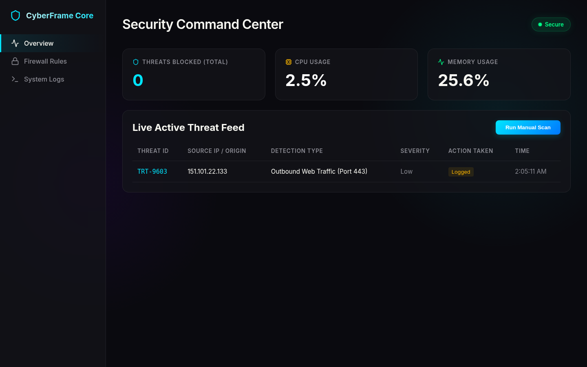

<div align="center">
  

  <h1>🛡️ CyberFrame Core</h1>
  <p><b>An open-source connection-monitoring engine and dashboard (FastAPI + React)</b></p>
  
  <p>
    
    
    
    
  </p>

  <p>
    <a href="#features">Features</a> •
    <a href="#quick-start">Quick Start</a> •
    <a href="#architecture">Architecture</a> •
    <a href="#contributing">Contributing</a>
  </p>
</div>

---

## 🚨 Why CyberFrame Core?



**CyberFrame Core** is an open-source security dashboard project. It provides a real-time Threat Detection Engine built in **Python** (FastAPI) combined with a glassmorphism dashboard built in **React** (Vite).

## ✨ Features
- **⚡ Real-Time Threat Engine**: Simulates and detects DDoS, XSS, and SQL Injection attempts.
- **🖥️ Live React Dashboard**: Premium glassmorphism UI for monitoring your endpoints.
- **🧱 Dynamic Firewall Rules**: Instantly block or allow IPs on the fly.
- **📊 Hardware Telemetry**: Live CPU and Memory usage tracking using `psutil`.
- **🗄️ SQLite Database**: Zero-config, out-of-the-box persistent threat logging via SQLAlchemy.

## 🚀 Quick Start (Run it in 30 seconds)

### 1. Start the Backend (FastAPI + Python)
```bash
cd backend
python -m venv venv
source venv/bin/activate
pip install -r requirements.txt
sudo env "PATH=$PATH" uvicorn main:app --reload --port 8000
```
*The backend will now stream simulated threat events at `http://localhost:8000/api/threats`.*

### 2. Start the Frontend (Vite + React)
Open a new terminal window:
```bash
npm install
npm run dev
```
*The beautiful UI is now live at `http://localhost:5173`.*

---

## 🧠 Architecture
This repository uses a decoupled **Monorepo** structure:
- `/backend`: The intelligent engine. Uses `psutil` for hardware metrics, `sqlalchemy` for fast threat persistence, and `fastapi` for blazing-fast REST APIs.
- `/src`: The command center. Built with Vite and React, utilizing `lucide-react` for iconography and custom vanilla CSS for the high-end dark glassmorphism aesthetic.

## 🤝 Contributing
We welcome all PRs! If you want to add new threat models to `backend/security.py` or new UI panels to `src/App.jsx`, just fork this repo and submit a Pull Request.

## 📄 License
MIT License. Completely free, forever. 
